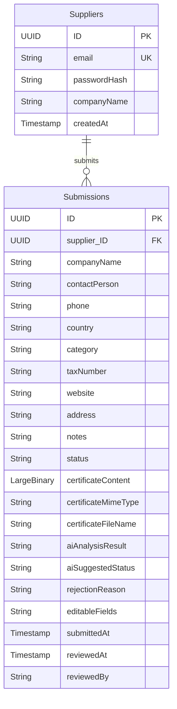

# 🏢 CodeUp Case Study — Supplier Management (Tedarikçi Onboarding & Onay)

<p align="center">
  
  
  
  
  
  
</p>

---

## 📌 Proje Genel Bakışı & Amacı

Bu proje, **CodeUp Case Study** gereksinimleri doğrultusunda geliştirilmiş kurumsal bir **Tedarikçi Onboarding & Onay Yönetim Platformu**'dur.

Geliştirici: **[Aygen5 (Aygen Yıldırım)](https://github.com/Aygen5)**  
Kaynak Kod Deposu: **[CodeUp-CaseStudy (GitHub)](https://github.com/Aygen5/CodeUp-CaseStudy.git)**

### 🎯 Temel Misyon
Kurumsal şirketler ile iş ortaklığı kurmak isteyen tedarikçilerin başvuru süreçlerini uçtan uca dijitalleştirmek; manuel evrak inceleme süreçlerini **yapay zekâ (Google Gemini)** desteğiyle hızlandırmak ve onay makamlarına **rol tabanlı (RBAC)** güvenli bir karar kokpiti sunmaktır.

---

## 👥 Hedef Kitle & Kullanıcı Rolleri

Platform iki ana kullanıcı kitlesine ve ayrıştırılmış güvenlik katmanlarına hitap eder:

| Kullanıcı Profili | Erişim Türü | Temel Fonksiyonlar & Yetenekler |
| :--- | :--- | :--- |
| **Dış Paydaşlar (Tedarikçiler)** | Public (Açık Erişim) | • Özel kayıt ve giriş arayüzü<br>• Canlı parola gücü doğrulama kuralları (regex & anlık geri bildirim)<br>• Kurumsal başvuru formu ve PDF sertifika akışı (streaming, maks. 10 MB)<br>• Süreç takibi (3 adımlı `ProcessFlow`: *Gönderildi ➔ İncelemede ➔ Karar*)<br>• Reddedilen başvurularda yalnızca izin verilen alanları güncelleyip yeniden başvurma (*Re-apply*) |
| **İç Paydaşlar (Onaycılar & Satınalma)** | Korumalı (`Approval` Rolü) | • BTP XSUAA üzerinden JWT doğrulamalı giriş<br>• Gelişmiş başvuru yönetim tablosu (`ViewSettingsDialog`, dinamik sütunlar, sıralama, filtreleme)<br>• Durum sekmeleri (`IconTabBar`: *Tümü, Bekleyen, Onaylanan, Reddedilen*)<br>• Dosyayı indirmeden tarayıcı içinde yerleşik **PDF önizleme**<br>• **Google Gemini AI ile Sertifika Geçerlilik Analizi** (Human-in-the-Loop)<br>• Gerekçeli red ve tedarikçiye düzenlenebilir alan yetkilendirmesi |

---

## 🏗️ Mimari Denklem ve Sistem Mimarisi

Projenin teknik omurgası kurumsal SAP bulut standartları üzerine kurulmuştur:

$$\mathbf{CAP\ Node.js} + \mathbf{SAP\ HANA\ Cloud} + \mathbf{SAPUI5} + \mathbf{XSUAA} + \mathbf{Approuter} + \mathbf{Fiori\ Launchpad} + \mathbf{BTP\ Destination\ /\ Gemini}$$

```
                                      [ Web Tarayıcısı ]
                                               │
                                               ▼ (Port 5000)
    ┌────────────────────────────────────────────────────────────────────────────────────────┐
    │                               Approuter (@sap/approuter)                               │
    │  - Tek Giriş Kapısı (Reverse Proxy)                                                    │
    │  - xs-app.json Rota Yönetimi                                                           │
    │  - BTP XSUAA OAuth2 / JWT Kimlik Doğrulama                                             │
    └──────────────┬─────────────────────────────────────────────────────────┬───────────────┘
                   │                                                         │
                   ▼ (Statik UI & Shell)                                     ▼ (OData V4 & Servis İstekleri)
    ┌───────────────────────────────────────────────┐       ┌────────────────────────────────┐
    │             Lokal Fiori Launchpad             │       │      CAP Node.js Backend       │
    │      (app/index.html + Sandbox Config)        │       │          (Port 4004)           │
    ├───────────────────────┬───────────────────────┤       │  - OData V4 Servis Katmanı     │
    │    Supplier Portal    │  Supplier Approvals   │       │  - Rol & Scope Denetimi (RBAC) │
    │    (Public / Dış)     │ (Korumalı / Onaycı)   │       │  - bcryptjs Şifreleme          │
    └───────────────────────┴───────────────────────┘       │  - PDF Binary Streaming        │
                                                            └───────────────┬────────────────┘
                                                                            │
                                           ┌────────────────────────────────┴───────────────┐
                                           ▼                                                ▼
                            ┌──────────────────────────────┐                ┌──────────────────────────────┐
                            │     SAP HANA Cloud (DB)      │                │       BTP Destination        │
                            │  - Suppliers & Submissions   │                │    (Google Gemini AI Ucu)    │
                            └──────────────────────────────┘                └──────────────────────────────┘
```

---

## 🚀 Projede Hayata Geçirilen Temel Modüller & Özellikler

### 1. 🌐 Merkezi Fiori Launchpad (`#Shell-home`)
- SAP ushell Sandbox altyapısı ile kurumsal birleşik ana ekran.
- İki dinamik kutucuk (tile): **Tedarikçi Portalı** ve **Tedarikçi Onayları**.
- XSUAA ile oturum açan gerçek kurumsal kullanıcının ad, soyad ve e-posta bilgilerini dinamik gösteren kabuk başlığı.

### 2. 📝 Tedarikçi Portalı (Supplier Portal)
- **Gelişmiş Güvenli Kayıt & Giriş:**
  - `bcryptjs` ile tek yönlü tuzlanmış (salted) şifre hash'leme (Veritabanında asla düz metin şifre tutulmaz).
  - Canlı parola kalite kontrolü: En az 8 karakter, büyük harf, küçük harf, rakam ve özel karakter sağlandıkça yeşile dönen interaktif kriter listesi.
  - Mükerrer e-posta engelleme ve kayıt sonrası otomatik oturum açma akışı.
- **Dinamik Başvuru Formu:**
  - Çift katmanlı veri validasyonu (UI5 istemci ve CAP servis katmanı).
  - Firma adı, ilgili kişi, telefon, ülke, kategori (*Hardware / Software / Services / Consulting*), vergi no, web sitesi, adres ve notlar.
- **PDF Sertifika Streaming:**
  - Yalnızca **PDF** formatında ve maksimum **10 MB** büyüklüğünde dosya kabulü.
  - CAP `LargeBinary` ve `@Core.MediaType` üzerinden veritabanına yüksek performanslı stream mimarisi.
- **Süreç Akış Göstergesi (`ProcessFlow`):**
  - Başvuru tamamlandığında form gizlenir ve yerini 3 adımlı süreç akışı alır.
  - Tedarikçi tekrar giriş yaptığında formu değil, güncel durumunu görür.
- **Akıllı Yeniden Başvuru (Re-apply):**
  - Başvuru reddedildiğinde onaycının karar gerekçesi açıkça listelenir.
  - "Tekrar Başvur" butonuna basıldığında, **yalnızca onaycının izin verdiği alanlar düzenlenebilir** olarak açılır; diğer alanlar salt-okunur (kilitli) kalır.

### 3. 🛡️ Onaycı Kokpiti (Supplier Approvals)
- **Güvenlik Duvarı:** `xs-security.json` üzerinde tanımlı `Approval` rolü (`codeup Approval` rol koleksiyonu) zorunludur; yetkisiz erişimler 403 ile engellenir.
- **Tablo Yönetimi & ViewSettingsDialog:**
  - Dinamik sütun görünürlüğü (Telefon, Ülke, Kategori, Vergi No, Web Sitesi, Adres vb.).
  - Gönderim tarihine göre artan/azalan sıralama, kategoriye göre filtreleme.
  - `IconTabBar` ile anlık statü filtreleme (*Tümü*, *Bekleyen*, *Onaylanan*, *Reddedilen*) ve serbest metin arama.
- **Yerleşik PDF Önizleme:**
  - Başvuru detay kartı üzerinden sertifikayı indirmeye gerek kalmadan tarayıcı içinde tam önizleme.
- **Karar Mekanizması:**
  - **Elle Onay:** Tek tıkla onaylama ve tedarikçi portalına anlık yansıma.
  - **Kural Tabanlı Red:** Onaycının karar gerekçesi girmesi ve tedarikçinin düzenleyebileceği alanları çoklu seçim kutusundan (Multi-combobox) seçmesi zorunludur.

### 4. 🤖 Google Gemini AI Destekli Sertifika Doğrulaması
- **Human-in-the-Loop İlkesi:** Yapay zekâ doğrudan onay/red kararı vermez; onaycıya akıllı bir karar önerisi sunar.
- **Belge Analizi:** Sistem yüklenen PDF sertifikasını okuyarak kurumsal bir **Geçerlilik Tarihi (Expiry Date)** arar.
- **Senaryolar:**
  - *Tarih geçerli ise:* Yeşil onay kartı ve tarih tespiti sunulur.
  - *Tarih bulunamazsa veya süresi dolmuşsa:* Kırmızı uyarı üretilir, karar notuna otomatik gerekçe eklenir ve tedarikçinin düzenleyebileceği alanlarda "Sertifika" otomatik seçilir.
- **Sıfır Hardcoded Secret:** Gemini API anahtarı kaynak kodda değil, SAP BTP Destination servisi üzerinden güvenle tüketilir.

---

## 🎨 Tasarım Standartları & İlkeleri

- 🚫 **Sıfır Özel CSS Kuralı:** Projede tek bir harici `.css` dosyası veya inline `style` etiketi bulunmaz.
- 💎 **SAP Fiori Horizon:** Resmi SAPUI5 kontrolleri (`DynamicPage`, `ProcessFlow`, `IconTabBar`, `ViewSettingsDialog`) ve SAP Horizon teması (`sap_horizon` / `sap_horizon_dark`) kullanılmıştır.
- 🌐 **Eksiksiz i18n & Otomatik Dil Algılama:**
  - Türkçe (`i18n_tr.properties`) ve İngilizce (`i18n_en.properties`) tam dil desteği.
  - Tarayıcının varsayılan diline göre otomatik geçiş; kodda hard-coded tek bir kelime bulunmaz.

---

## 🗄️ Veri Modeli ve Varlıklar (CDS Schema)



---

## 🧪 Kapsamlı Test Otomasyonu (21 E2E Test Paketi)

Sistem, iş mantığını ve sınır durumlarını doğrulayan 21 adet uçtan uca test modülüyle donatılmıştır:

```
test/
├── test-approuter-routing-e2e.js              # Approuter reverse-proxy ve güvenlik rotaları
├── test-btp-xsuaa-hybrid-e2e.js               # BTP XSUAA hybrid kimlik doğrulama
├── test-sap-hana-cloud-e2e.js                 # SAP HANA Cloud veritabanı entegrasyonu
├── test-gemini-integration.js                 # BTP Destination üzerinden Gemini AI testi
├── test-fiori-sandbox-e2e.js                  # Fiori Launchpad ushell sandbox testi
├── test-theme-management-e2e.js               # Horizon açık/koyu tema uyumluluğu
├── test-auth-view-e2e.js                      # Canlı parola kuralları ve kayıt/giriş
├── test-application-form-e2e.js               # Başvuru formu ve çift katmanlı validasyon
├── test-processflow-e2e.js                    # 3 adımlı süreç akışı takibi
├── test-reapply-e2e.js                        # Korumalı alanlarla yeniden başvuru akışı
├── test-supplier-approvals-table-e2e.js       # Sütun ayarları, arama ve IconTabBar
├── test-supplier-approvals-detail-e2e.js      # Detay kartı ve PDF tarayıcı önizlemesi
├── test-supplier-approvals-approve-e2e.js     # Onay aksiyonu ve durum güncellemeleri
├── test-supplier-approvals-reject-e2e.js      # Gerekçeli ve alan seçimli red mekanizması
├── test-supplier-approvals-ai-e2e.js          # AI analiz önerisi ve human-in-the-loop
├── test-approval-service.js                   # ApprovalService RBAC ve CRUD kontrolleri
├── test-public-service.js                     # PublicService açık uç kontrolleri
└── files/                                     # Pozitif & negatif PDF test belgeleri
```

### 🔴 Zorunlu Negatif Test Senaryoları
1. ❌ **10 MB'tan büyük dosya yükleme:** Boyut sınırı aşım uyarısı.
2. ❌ **PDF olmayan dosya formatı:** Format uyuşmazlığı engeli.
3. ❌ **Mükerrer e-posta ile kayıt:** Zaten var olan e-posta uyarısı.
4. ❌ **Hatalı şifre ile giriş:** Kimlik doğrulama reddi.
5. ❌ **Zorunlu alanlar boşken başvuru:** Eksik alan validasyon kalkanı.
6. ❌ **Yetkisiz kullanıcı ile onay paneline erişim:** 403 Forbidden engeli.
7. 🌐 **Tarayıcı dili değiştirme:** TR/EN metinlerinin dinamik adaptasyonu.

---

## 💻 Kurulum ve Çalıştırma

### Gereksinimler
- Node.js (v18 veya v20 LTS)
- SAP CDS Development Kit (`npm install -g @sap/cds-dk`)
- BTP Cloud Foundry CLI (Opsiyonel: BTP dağıtımları için)

### 1. Bağımlılıkları Yükleme
```bash
git clone https://github.com/Aygen5/CodeUp-CaseStudy.git
cd CodeUp-CaseStudy
npm install
```

### 2. Uygulamayı Başlatma (Hybrid / Local)
Tüm servisleri (CAP Backend, Approuter ve Local Fiori Launchpad) tek bir komutla eşzamanlı ayağa kaldırın:
```bash
npm start
```
* **Approuter (Giriş Noktası):** `http://localhost:5000`
* **Fiori Launchpad:** `http://localhost:5000/index.html#Shell-home`
* **CAP Backend OData V4:** `http://localhost:4004`

### 3. Testleri Çalıştırma
```bash
node test/test-e2e-api.js
```

---

## 📁 Dizin Yapısı

```
CodeUp-CaseStudy/
├── app/
│   ├── appconfig/                 # Fiori Sandbox Launchpad konfigürasyonu
│   ├── supplierportal/            # Tedarikçi Portalı UI5 freestyle uygulaması
│   ├── supplier-approvals/        # Onaycı Portalı UI5 freestyle uygulaması
│   └── index.html                 # Birleşik Fiori Sandbox Launchpad ana kabuğu
├── db/
│   ├── schema.cds                 # CDS Veri modelleri (Suppliers, Submissions)
│   └── data/                      # 12 kurumsal başlangıç tohum verisi (CSV)
├── srv/
│   ├── public-service.cds         # Herkese açık OData V4 servis tanımları
│   ├── public-service.js          # Kayıt, bcrypt şifreleme ve form iş mantığı
│   ├── approval-service.cds       # Approval rolüne bağlı yetkili servis
│   ├── approval-service.js        # Onay, red ve Gemini AI analiz işleyicileri
│   └── gemini-client.js           # BTP Destination üzerinden Gemini REST köprüsü
├── test/                          # 21 adet E2E test dosyası ve mock test dosyaları
├── xs-app.json                    # Approuter rota, güvenlik ve hedef yapılandırması
├── xs-security.json               # XSUAA rol ve scope yetki şeması
├── approuter.js                   # Özel Approuter başlatıcısı
└── run-hybrid.js                  # Çift portlu eşzamanlı başlatma betiği
```

---

## 👨‍💻 Geliştirici & Lisans

Bu proje, **CodeUp** bünyesindeki vaka çalışması (Case Study) değerlendirmesi için **[Aygen5](https://github.com/Aygen5)** tarafından SAP ve BTP kurumsal geliştirme standartlarına uygun olarak tasarlanmış ve kodlanmıştır.

© 2026 Aygen5. Tüm hakları saklıdır.
